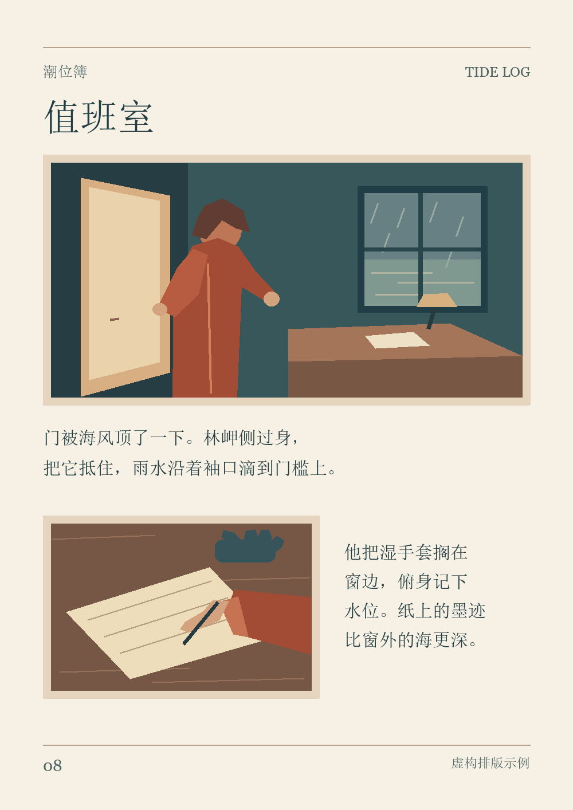

# 插图书制作 · Illustrated Book Production

一个用于 Codex 的插图书制作技能。从已有手稿出发，按页构思插图、安排图文、记录审定版本，并按需交付 HTML 预览、电子书 PDF 或可编辑 InDesign 印刷包。适合从头做一本书，也适合接手已经排了一半的书稿。

## 书页示例

《潮位簿》是一个为本仓库编写的虚构案例。第 8 页写潮汐观测员进值班室、摘下手套、抄下读数。

上图用横幅交代门、窗、桌子与人物的位置。下图只留下笔尖、记录纸、手套和雨衣袖口，版面缩小后仍能读懂动作。两张图共用值班室的空间参考，并沿用同一件雨衣。示意页把第二张插图和后半段正文并排，偶数页码落在左下外侧。

如果作者后来批准了新版书写近景，可以按图位 **08-02** 找到相应的图片，在 HTML 和 InDesign 中同步替换，再重新导出并核对 PDF。[查看虚构案例的图位记录](illustrated-book-production/references/example.md)

## 怎么协作

| 阶段 | 你可以决定什么 | 技能会做什么 |
| --- | --- | --- |
| 插图规划 | 选叙事时刻、画风和镜头方向 | 按页拆分图位，明确每幅图讲什么，并为裁切预留空间 |
| 画布准备 | 选模型、参考图以及谁提交和审图 | 写明动作、景别和光线，逐一注明参考图负责脸、服装、场景还是道具 |
| 页面排版 | 指定字号、版心、页码、留白和图文关系 | 保持原稿字句，检查溢排、裁切、图框衬边和书页节奏 |
| 修订与交付 | 指定批准版本和需要更新的格式 | 按页码与图位替换素材，核对各版本的成品表现 |

开始时可提供手稿或现有排版文件，以及已经定下来的风格、尺寸和审核方式。插图尚未审定时，可以先完成分镜和画布草稿。已有批准稿时，可以直接从指定页开始排版或替换图片。

## 交付格式

- **HTML 预览**可翻页、跳转，适合在浏览器里逐页审阅。
- **电子书 PDF**沿用阅读页序，核对正文能否搜索和复制，并按需要添加书签。
- **InDesign 印刷包**保留可编辑文字和图片链接。出血、书脊尺寸、布面或纹理纸的处理沿用印方规格。

[查看各格式的交付与验收细节](illustrated-book-production/references/delivery.md)

## 在 Codex 中使用

将仓库内的 `illustrated-book-production` 文件夹复制到个人的 `~/.codex/skills/` 目录，然后用 `$illustrated-book-production` 调用。

> 用 $illustrated-book-production 规划这份手稿的前两页插图。按页给出镜头和参考图安排，等我确认后再准备画布草稿。

也可以直接发起局部修订，例如「把第 8 页第 2 张换成我批准的新版本，同步 HTML 与 InDesign，核对正文没有溢出」。

仓库中的故事、文本和书页图均为虚构示例。
